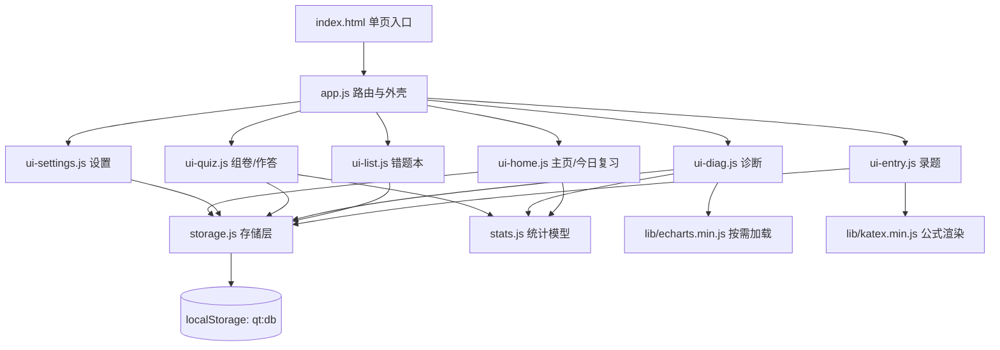
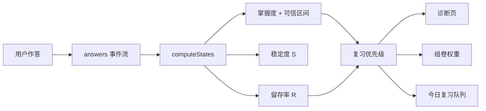
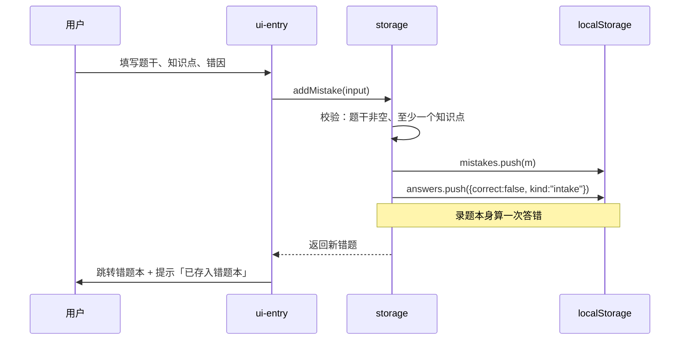

# 系统设计说明

## 一、目标与约束

本作品要解决的问题：学生做错题后**记不住、也不知道该先补哪里**。
市面上的错题 App 多需要注册、上传、联网，且只做「存」，不做「诊断」。

三条硬约束决定了整体架构：

| 约束 | 推论 |
|---|---|
| 中国大陆手机必须能打开 | 静态部署 + **离线 zip 兜底**，不能依赖 CDN、不能依赖服务器 |
| 个人作品、无运维预算 | 纯前端，无后端、无数据库、无账号 |
| 数据是学生的隐私 | 全部数据留在本机 `localStorage`，提供导出备份供用户自己保管 |

## 二、总体架构



**分层原则**：

| 层 | 文件 | 职责 | 依赖 |
|---|---|---|---|
| 工具层 | `util.js` | 转义、日期、公式渲染、提示条、页面注册表 | 无 |
| 数据层 | `data.js` | 科目、预置知识点、错因标签（只读常量） | 无 |
| 存储层 | `storage.js` | CRUD、迁移、备份 | `util` `data` |
| 统计层 | `stats.js` | 三个模型（纯函数，不碰 DOM 与存储） | 无 |
| 界面层 | `ui-*.js` | 渲染与交互 | 以上全部 |
| 外壳 | `app.js` | 路由、标签栏、页面生命周期 | 界面层 |

`stats.js` **刻意不依赖 storage**，因此可以单独在 Node 里测试。这是它能做到 45 项测试的前提。

## 三、为什么不使用 ES6 模块

任务书要求「不用构建工具」，同时又要求「微信发 zip 直接打开」。这两条叠加后，
`<script type="module">` 不可用：

```
file:// 协议下，浏览器把每个模块文件当作跨域请求 → 被 CORS 策略拒绝
Uncaught TypeError: Failed to fetch dynamically imported module
```

所以改为**经典脚本 + 全局命名空间**：

```js
(function (global) {
  'use strict';
  var QT = (global.QT = global.QT || {});
  QT.pages = QT.pages || {};      // 在 util.js 里提前建好
  // ... 模块实现 ...
  QT.storage = { /* 导出 */ };
})(typeof globalThis !== 'undefined' ? globalThis : this);
```

加载顺序由 `index.html` 里的 `<script>` 标签保证，且因为挂了 `globalThis` 而不是 `window`，
同一份代码在 Node 里 `require` 后立即可用（测试正是这么做的）。

## 四、数据流

### 4.1 核心设计：只存事件，派生一切



**任何派生量都不落盘。** 这样做的三个直接收益：

1. 删除错题 → 相关事件一并删除 → 掌握度自动回滚，无需手工同步
2. 用户改了错题的知识点 → 历史事件保持不变（那是当时的事实），新事件按新知识点计入
3. 调整算法参数（如 `S0`、`×2`）后，历史数据立即按新参数重算，无需迁移数据

代价是每次渲染都要重算。数据量级是「一个学生一学期的错题」（数百条），
`computeStates` 是 O(事件数 × 每事件知识点数)，实测无感知延迟。

### 4.2 错题录入的两步写入



## 五、路由设计

用 hash 而非 History API，原因：静态托管下 `file://` 和纯静态服务器都没有 SPA 回退，
`/list` 这类路径刷新会 404。

| 路由 | 页面 | 说明 |
|---|---|---|
| `#/home` | 主页 | 概览 + 今日复习 + 最薄弱知识点 |
| `#/list` | 错题本 | 筛选条件写在 query 里，刷新保持状态 |
| `#/entry` | 录题 | `?id=xxx` 进入编辑模式 |
| `#/diag` | 诊断 | `?subject=xxx` 按科目过滤 |
| `#/quiz` | 组卷 | `?stage=setup\|paper\|result` 三阶段 |
| `#/settings` | 设置 | 从主页进入，不在标签栏 |

**组卷把题目 id 写进 URL**（`?stage=paper&ids=a,b,c`）：
刷新时若重新抽样，用户做到一半的题会变、答案对不上。URL 是唯一能跨刷新、
跨标签页可靠承载「当前这份试卷」的载体。

## 六、模块清单

| 文件 | 行数（实测） | 关键职责 |
|---|---|---|
| `util.js` | 126 | `esc` 转义、`fmtDate`、`renderRichText`（先转义再渲染公式）、`toast` |
| `data.js` | 219 | 4 科 71 个知识点、5 种错因、v1 旧数据对照表 |
| `storage.js` | 475 | 读写、迁移、错题/事件 CRUD、导入导出 |
| `stats.js` | 425 | Beta 分位数、掌握度、遗忘曲线、抽样、复习队列 |
| `ui-home.js` | 187 | 复习卡、概览数字、薄弱点列表 |
| `ui-entry.js` | 227 | 表单、知识点多选、新增知识点、删除确认 |
| `ui-list.js` | 168 | 筛选下拉、分页（每次 30 道）、卡片 |
| `ui-diag.js` | 320 | 文字诊断、雷达图、错因饼图、科目柱状图 |
| `ui-quiz.js` | 325 | 抽题、作答、自评、交卷回写、结果页 |
| `ui-settings.js` | 122 | 备份导出/导入、清空 |
| `app.js` | 136 | 路由解析、标签栏、页面 `render`/`after`/`dispose` |

> ⚠️ `storage.js`（475 行）与 `stats.js`（425 行）**超过了任务书「单文件尽量不超过 400 行」的建议**。
> 理由：这两个文件的超长部分主要来自注释（迁移映射表、算法推导说明），代码本身并不复杂。
> 强行拆分会让 `stats.js` 失去「单文件纯函数、可直接 Node 测试」的优势。
> 在 D7 之前不再调整文件结构（改动风险大于收益）。

## 七、第三方库的本地化策略

| 库 | 体积 | 加载方式 | 理由 |
|---|---|---|---|
| KaTeX 0.16.9 | 277 KB + CSS 23 KB + 20 个 woff2 字体 | 首屏同步加载 | 题干里的公式必须在首屏就正确显示 |
| ECharts 5.5.0 | 1,029 KB | **诊断页按需加载** | 首屏多等 1 MB 对手机流量不友好；用动态 `<script>` 而非 `fetch`（`file://` 下 fetch 会被 CORS 拦） |

**降级策略**：ECharts 加载失败时，诊断页的图表区显示提示，**下方表格数据照常可用**。
公式同理：没有 KaTeX 时公式显示为源码，页面不报错。

## 八、错误处理原则

| 场景 | 处理 |
|---|---|
| `localStorage` 配额满 | 抛异常 → 界面提示「导出备份后清理」，而不是静默丢数据 |
| 数据 JSON 解析失败 | 返回空库而不是白屏（宁可丢一次显示，也不能让用户以为 App 坏了） |
| 单个页面渲染抛异常 | `app.js` 捕获并把错误信息显示在页内，附「重新加载」按钮 |
| 导入非法文件 | 校验结构，给出中文错误（「不是合法的 JSON 文件」/「缺少 mistakes 数组」） |
| 题目在组卷后被删除 | 作答页检测到题目不存在 → 提示「这份练习的题目已不存在」+ 重新组卷按钮 |

## 九、移动端适配

- 视口 `width=device-width, initial-scale=1, viewport-fit=cover`
- 底部标签栏固定，高度含 `env(safe-area-inset-bottom)`，避免被 iPhone 手势条挡住
- 正文最小 14px，可点区域最小 40px（实测最小按钮高度 = 40px）
- 375px 视口下**无横向溢出**（实测 `scrollWidth === innerWidth === 375`）
- 最大宽度 720px，桌面端居中显示，不会拉成一条长线

## 十、输入子系统（录题效率专项，阶段 1–4 增补）

录题链路的目标：**用户不需要会 LaTeX，不需要打符号键盘**。

```mermaid
flowchart LR
  A[用户输入<br>拍照 / 相册 / 打字 / 粘贴] --> B{输入类型}
  B -->|图片| C[压缩管线<br>image-pipeline.js<br>长边≤1280 JPEG 0.72→0.5]
  C --> D[待提交池<br>ui-entry-photo.js<br>objectURL 缩略图]
  D -->|保存时| E[(IndexedDB qt-images<br>存 Blob 不存 base64)]
  B -->|文字| F[实时预览<br>防抖 150ms]
  F --> G[公式工具栏<br>symbols.js + ui-toolbar.js<br>insertAt 纯函数插入]
  G --> F
  B -->|保存| H[normalizeMath 规范化<br>全角→半角 / \( \)→$ / 中文包 text]
  H --> I[(localStorage qt:db<br>schemaVersion 3)]
  E -. imageIds 关联 .-> I
```

各环节的设计决定：

| 环节 | 文件 | 关键决定 | 理由 |
|---|---|---|---|
| 文本规范化 | `mathtext.js` | 保存前 `normalizeMath`，渲染前也走一遍 | 用户粘贴的 `\( \)`、全角字符都能活 |
| 公式工具栏 | `symbols.js`（数据+纯函数）/ `ui-toolbar.js`（DOM） | 插入逻辑全部在纯函数 `insertAt` 里；按钮 `pointerdown + preventDefault` 保住输入法键盘；工具栏固定在 `visualViewport` 底部跟随软键盘 | 纯函数可测（26 项测试含「每个符号都能被 KaTeX 渲染」）；键盘不收起是手机可用性的生死线 |
| 图片压缩 | `image-pipeline.js` | 算尺寸/质量的**纯函数**与画 canvas 的浏览器函数分离；`createImageBitmap` 优先处理 EXIF，退化 ``+canvas | 「怎么算」在 Node 测试，「怎么画」浏览器实测 |
| 图片存储 | `image-store.js` | `ImageStore` 接口：内存实现（测试）+ IndexedDB 实现；打开失败 resolve null，UI 降级；孤儿清理只走键游标不载 blob | 图片进 localStorage 会撑爆 5MB；降级必须显式而不是悄悄丢图 |
| 录入埋点 | `entry-metrics.js` | `entry_open` / `entry_save`（ms、模式、点击数、照片数、字数），白名单导出；不可见>5min 或总时长>30min 丢弃 | 报告需要真实耗时数据；载荷绝不带文本（隐私测试锁定） |
| 光标与占位符 | `symbols.js` | `▮` 占位符；插入后选中第一个 ▮；自动包 `$` 时光标停在**闭 $ 之前** | 基准脚本真实模拟时抓到两处光标 bug（见测试报告缺陷清单） |
